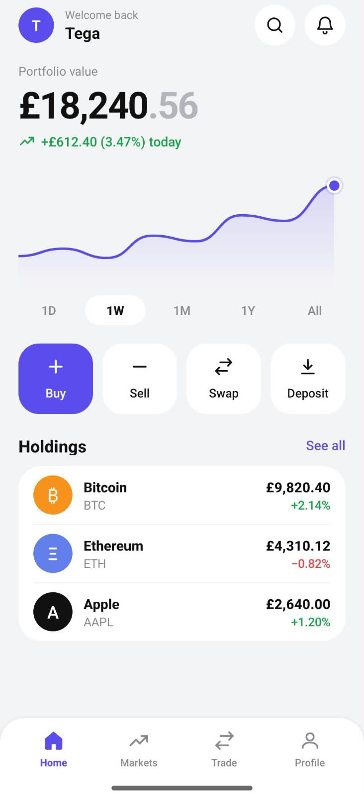
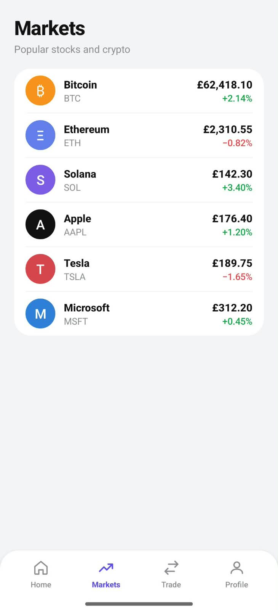
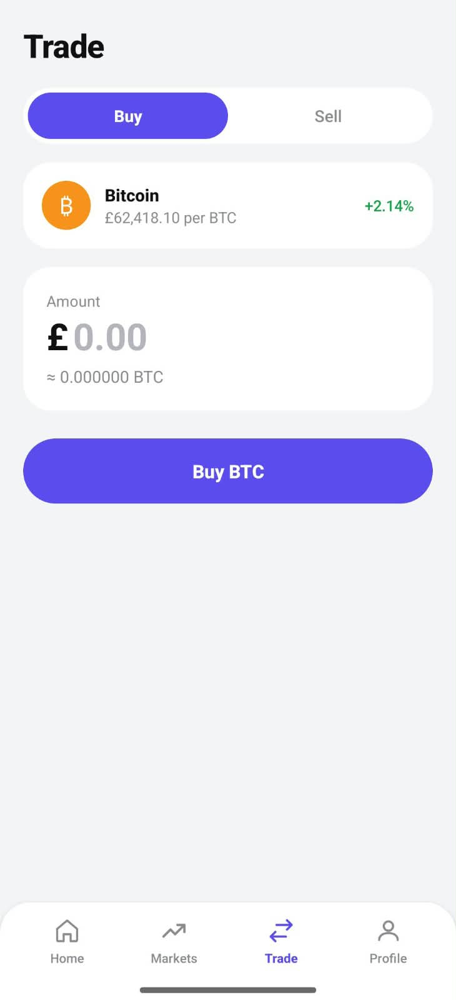
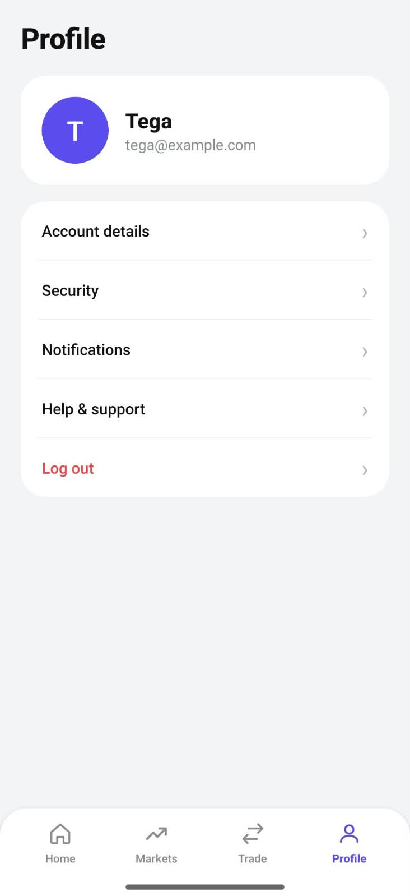

# InvestApp

A clean, modern investing app UI for Android (stocks and crypto), built with Java and XML in Android Studio.

> This is a UI portfolio project. All prices and balances are sample data, no real trading happens.

## Screenshots

| Home | Markets | Trade | Profile |
|------|---------|-------|---------|
|  |  |  |  |
## Features

- **Home:** portfolio value, performance chart with a custom-drawn line and gradient fill, time filters (1D, 1W, 1M, 1Y, All), quick actions (Buy, Sell, Swap, Deposit) and a holdings list
- **Markets:** list of popular stocks and crypto with price and daily change
- **Trade:** Buy / Sell switch with an amount field that shows a live BTC estimate
- **Profile:** user card and settings list
- Bottom navigation built with fragments
- Light theme, rounded cards, consistent spacing

## Tech stack

- Java
- XML layouts and vector drawables
- Android Fragments and a bottom navigation bar
- Custom `View` (`ChartView`) drawn with `Canvas` and `Path`
- Min SDK 24, Target SDK 34

## How to run

1. Clone the repository
2. Open the folder in Android Studio
3. Wait for Gradle sync to finish
4. Run the `app` configuration on an emulator or a real device

## Author

**Waleed Arshad**, Android developer
GitHub: [itxwaleed007-dotcom](https://github.com/itxwaleed007-dotcom)
